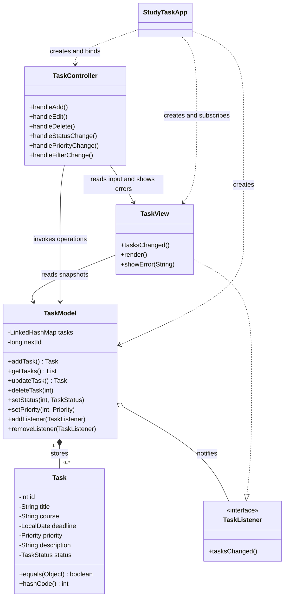
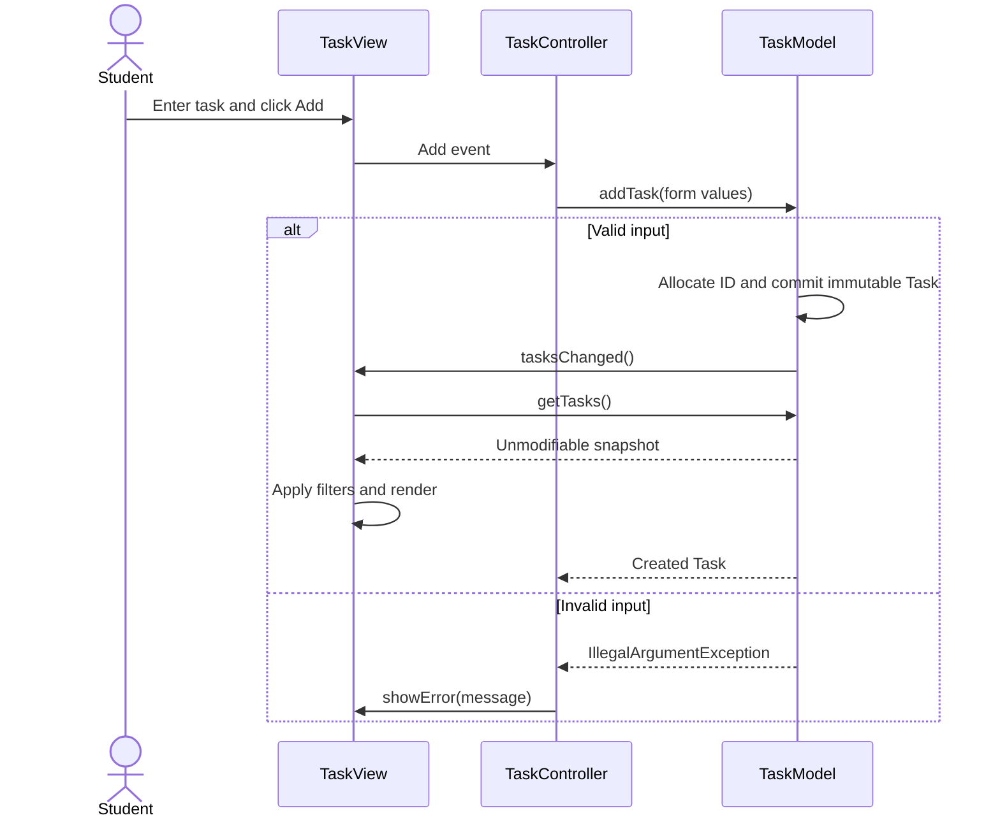

# Design System: StudyTask

## Overview

**Creative North Star: "Campus wayfinding"**

The native JavaFX workspace uses a navy course rail, a quiet cool ground and aligned task rows to make course, deadline and state easy to scan. Blue identifies actions and selection; timing and completion receive restrained semantic color and explicit words.

This is a code-led record of the implemented desktop surface, with no approved visual comp. Evidence is `src/main/resources/studytask.css`, `src/main/java/studytask/view/TaskView.java`, `PRODUCT.md`, `.impeccable/surfaces/workspace.md` and the desktop, compact, empty and error captures in `.impeccable/review/`. The existing course architecture follows these visual sections unchanged.

**Key Characteristics:**

- Native controls with visible keyboard focus.
- Aligned task rows with course and relative deadline context.
- Flat surfaces separated by tone and fine borders.
- Adjacent editing with persistent actions and retained input on errors.

## Colors

Cool navy and blue organize the surface; amber, red and green communicate task meaning. Frontmatter records the native stylesheet literals, without constructing an unused tonal scale.

### Primary

Action blue identifies primary buttons, text actions and field focus. Its darker hover and pressed variants provide immediate feedback. Pale blue selection connects the selected task to the adjacent editor.

### Secondary

Amber timing marks high priority and approaching deadlines. Danger red marks overdue timing, deletion and validation errors. Success green marks completed work and successful form feedback. Pending state uses a neutral slate treatment.

### Neutral

The shell supports white course names and lighter secondary text. Cool ground frames white table and editor surfaces. Border and row-divider tokens maintain structure without shadows. Muted ink supports dates, summaries and hints; prompt text has its own distinct value.

### Named Rules

**The Words With State Rule.** Pair semantic color with explicit status, priority or relative deadline text.

## Typography

**Body Font:** Segoe UI, as declared by the JavaFX root. No custom fallback, tracking or line-height is specified. Rail explanatory text alone sets native line spacing to 4.

### Hierarchy

Body and task names use 13px; task names are bold. Metadata, field labels and editor action labels use 12px, with bold field labels and action labels. State chips use 11px. Rail introductory text uses 14px.

Observed headings are 26px bold for the page, 22px bold for the brand, and 19px bold for pane and empty-state titles. These sizes describe the shipped build; their inherited system display face is a craft-floor defect, excluded from normative display typography tokens. The direction contract's provisional 20px brand and 16px pane title did not ship.

## Layout

The window opens at 1280 by 820 with a 900 by 640 minimum. A 188px course rail precedes a flexible task area and a 310px editor. Below 1150px view width, the rail is hidden, a course combo appears above the table and the editor becomes 280px wide. This is compact desktop behavior; no mobile layout is established.

The work area has native padding of 28 24 20 24; rail padding is 30 18 24 18; editor fields use 28 22 16 22. Table rows have fixed height 68 and headers preferred height 39. The task cell combines title and course; the deadline cell combines calendar date and relative timing. Columns remain aligned, unsortable and non-reorderable, with constrained resizing.

Actual gaps follow component needs: 4 between paired text, 7 between field labels and controls, 8 between actions, 14 between form groups, 18 in the task-area stack and 22 in the rail. The build does not implement the direction note's uniform 8/12/16/24/32 scale.

**The Persistent Actions Rule.** Scroll the editor fields independently while keeping feedback and save, status, clear and delete actions in the editor's bottom region.

## Elevation & Depth

Application styles introduce no shadows, gradients or animation. White surfaces, a dark rail, selected-row tint and fine borders establish depth. Native popup behavior remains controlled by JavaFX rather than a new custom elevation system.

**The Flat Surface Rule.** Use tone and borders to separate the workspace regions.

## Shapes

Controls and scrollbar thumbs use gently rounded 6px corners. Small status labels use 4px corners. The table and editor remain rectangular structural regions; the editor has a one-pixel left border and the action area a one-pixel top divider. Native date and combo affordances remain native.

## Components

### Buttons

Primary actions are blue with white bold text, secondary actions use a pale surface and dark blue text, and deletion uses a pale red surface with danger text. General padding is 10 15; persistent editor actions override this to 9 10 and 12px type. Text actions use transparent backgrounds and 6 4 padding. Hover changes fill; the primary button also darkens while pressed. Focus uses a 2px blue border with -2 insets. Disabled buttons and toggles use opacity 0.45.

### Inputs / Fields

White native fields have a muted border, prompt text and 6px corners. Text fields use 10 11 padding; text-area content uses 10. Focus changes the border to action blue at 2px with -1 insets. Visible labels are associated with their controls. Errors appear as wrapped red text in the persistent action region while typed values remain available. The description field wraps and is constrained between 100 and 130px in height.

### Navigation

Course buttons contain the course name and actual task count, using transparent default, lighter navy hover and selected fills. Status toggles use muted default text, pale blue selected fill and bold selected text. The compact course combo replaces the rail without changing the filtering model.

### Task table and state labels

The white table uses a cool header, horizontal row dividers, pale hover and selected fills. Task names and courses provide tooltips for long content. State labels use explicit Pending or Completed words and restrained neutral or green fills. Deadlines combine a full date with Finished, overdue, Due today, Tomorrow or days remaining; priority is written as text.

### Empty and error states

An empty task list offers opt-in example tasks. Filtered emptiness explains how to adjust or clear filters. Inline validation preserves entered values. The automatic local storage notice remains visible in the table footer, with an additional rail notice at wide widths. Destructive actions use a native confirmation dialog.

## Do's and Don'ts

### Do:

- **Do** pair semantic color with explicit status, priority or relative deadline text.
- **Do** keep the task list visible while editing and preserve input on errors.
- **Do** keep action feedback and editor actions outside the scrollable fields.
- **Do** use native controls with visible focus and associated field labels.

### Don't:

- **Don't** treat the provisional direction sizes as shipped typography values.
- **Don't** introduce decorative shadows or motion into the flat workspace without an approved system change.
- **Don't** promote the inherited system display face into a reusable display-font rule.

Not canonized: Segoe UI used as the brand/page/pane display face remains a craft-floor defect; no typography redesign was authorized for this documentation pass. Provisional type and spacing drift is recorded from the build rather than repaired.

Implementation reconciliation: the preserved course design below is the original accepted architecture and historical verification plan. The implemented model uses `long nextId` to detect exhaustion before allocating an `int` task ID; its original class diagram still says `int nextId`. The native implementation combines title and course within one Task column, provides an adjacent editor with scrollable fields and persistent actions, and has implementation/test evidence supplied by the build. Historical statements below about a proposed layout or unimplemented tests describe the original design step, not the current implementation status.

# StudyTask software design

Design specification for the seven functional requirements. Proposed implementation: Java and JavaFX.

## 2.1 Design overview

StudyTask is a Java desktop application with a JavaFX interface. The design covers FR-01 through FR-07 using MVC and the Observer pattern. The application saves tasks locally after each change and restores them on startup.

Task is an immutable domain object. TaskModel owns the mutable collection of tasks. TaskView displays information, and TaskController handles user actions. StudyTaskApp creates and connects these objects. All user actions and view updates run on the JavaFX application thread.

## 2.2 MVC responsibilities

Model: TaskModel stores tasks in a private LinkedHashMap<Integer, Task>, assigns positive IDs that are never reused across restarts, validates changes, and returns immutable snapshots. It has no JavaFX dependencies. Task, Priority and TaskStatus belong to the model package. TaskStore persists the collection and next ID using a temporary file and atomic replacement.

View: TaskView contains a task table, an input form, course and status filters, and action buttons. It implements TaskListener and refreshes from the model after a successful change. The view displays validation messages and does not modify model data directly.

Controller: TaskController receives UI events, reads form values, invokes model operations, and displays errors through the view. Filter selections are presentation state: changing a filter rebuilds the displayed snapshot without modifying stored tasks.

Composition root: StudyTaskApp loads the saved model, constructs the view and controller, registers the view as a listener, binds controller handlers, renders the initial state, and unregisters the listener when the window closes.

## 2.3 Observer pattern

TaskModel is the subject. TaskListener declares tasksChanged(), and TaskView implements this interface. The model exposes addListener(listener) and removeListener(listener). The application uses this small interface rather than the legacy Java Observable class.

After a valid add, replacement or deletion, TaskModel commits the change and notifies each registered listener once. TaskView then reads getTasks(), reapplies its active filters and refreshes the table. A rejected operation leaves the model unchanged and sends no notification.

Observer is central to the design because task updates reach the interface without the model depending on JavaFX. New views can subscribe without changing task operations. Listener registration is unique, and notification iterates over a snapshot of listeners.

## 2.4 Immutable Task ADT

Abstract value: a study task identified by id, with title, course, deadline, priority, description and completion status. Fields are private and final. Task is final, has no setters, and exposes only immutable values: int, String, LocalDate and enums.

Fields: id: int; title: String; course: String; deadline: LocalDate; priority: Priority; description: String; status: TaskStatus. Priority values are LOW, MEDIUM and HIGH. TaskStatus values are PENDING and COMPLETED.

Construction: TaskModel allocates the ID. A new task starts as PENDING. Title and course are trimmed and must contain non-whitespace text. Description is required to be non-null but may be empty. A deadline is required; past dates are allowed so overdue work remains representable.

Updates create a new Task with the same id and updated values. TaskModel replaces the stored value only after validation. Existing Task references and previously returned snapshots remain unchanged. Deleted IDs are not reused.

## 2.5 Representation invariant and abstraction function

Task RI: id > 0; title != null and title equals title.trim() and is not blank; course != null and course equals course.trim() and is not blank; deadline != null; priority != null; description != null; status != null. The constructor enforces every condition.

Task AF: AF(t) is the academic task identified by t.id, titled t.title, associated with t.course, due on t.deadline, carrying t.priority and t.description, and finished exactly when t.status is COMPLETED.

TaskModel RI: the task map and listeners contain no null values; every map key equals its Task.id; all stored tasks satisfy Task RI; nextId is positive and greater than every previously allocated ID; listeners contain no duplicates. ID exhaustion is rejected before integer overflow.

TaskModel AF: AF(model) is the collection of current study tasks represented by the map values in insertion order. Identity uniqueness is enforced within this model. Two immutable versions of one task may legitimately share an ID.

## 2.6 Equality and hashing

Task.equals(other) is true exactly when other is a Task with the same id. Task.hashCode() returns Integer.hashCode(id). The ID denotes a logical task throughout its lifetime; changing its course, deadline, priority or status does not change its identity.

This permits a HashSet<Task> to represent a selected-task set without duplicate versions of the same task and keeps membership stable across immutable replacements. A HashMap<Task, ...> can likewise use stable task keys. TaskModel itself uses Integer IDs as map keys; its map alone is not the justification for Task equality.

A set that already contains an older task version must explicitly replace that value when current details are required. Tasks with different IDs are unequal even if all visible fields match. The persisted next ID preserves this identity policy across application restarts.

## 2.7 Main operations and contracts

addTask(title, course, deadline, priority, description) -> Task: validates input, allocates an ID, inserts a PENDING task, notifies observers, and returns the created task. Invalid input changes nothing.

getTasks() -> List<Task>: returns an unmodifiable snapshot in insertion order. Callers cannot mutate the model collection through this result.

updateTask(id, title, course, deadline, priority, description) -> Task: requires an existing ID, preserves its status, validates a replacement, stores it, and notifies observers.

deleteTask(id): requires an existing ID, removes exactly that task, and notifies observers. setStatus(id, status) and setPriority(id, priority) replace the task while preserving all other fields.

Unknown IDs and invalid values produce IllegalArgumentException with a useful message. A request that makes no actual change sends no notification. A cancelled deletion never calls the model.

Filtering uses an optional status and an optional course. All disables the corresponding filter; when both are active, both must match. Course matching uses trimmed names without case sensitivity. Filtering preserves insertion order and never removes stored tasks.

## 2.8 User interface and interaction

The main window has a StudyTask title, course and status filters, and a table with Title, Course, Deadline, Priority and Status columns. A details area shows the selected task description. The form provides title, course, date picker, priority selector and description.

Add saves a new task from the form. Selecting a row loads its details for editing. Save Changes updates the selected ID. Delete asks for confirmation. Mark Completed or Mark Pending changes status. A priority selector and Change Priority action support FR-06 directly.

Save Changes, Delete, status and priority actions are disabled without a selection. Successful operations clear obsolete selections and refresh the filtered table. Filters stay active, so a task can disappear from the current view after its status or course changes. Empty results display No tasks match the selected filters.

Example flow: the student enters a project and clicks Add; the controller calls addTask; the model validates and stores the task; tasksChanged() fires; the view reads the new snapshot and refreshes. On invalid input, the controller displays the error and retains the form values.

## 2.9 Requirements traceability and planned verification

FR-01 Add Task: addTask and the input form. Verify all fields, initial PENDING status, a unique positive ID, and rejection of blank titles or courses.

FR-02 View Tasks: getTasks and the table/details area. Verify every field is visible and a returned snapshot cannot alter the model.

FR-03 Edit Task: updateTask and Save Changes. Verify the ID and status are preserved and the old Task instance remains unchanged.

FR-04 Delete Task: deleteTask and confirmation. Verify confirmed removal, cancelled deletion, and rejection of unknown IDs.

FR-05 Update Task Status: setStatus and the status action. Verify both transitions and preservation of all other fields.

FR-06 Change Task Priority: setPriority and the priority action. Verify LOW, MEDIUM and HIGH and preservation of unrelated fields.

FR-07 Filter Tasks: view filtering over a snapshot. Verify each filter, combined filters, All, case-insensitive course matching and empty results.

Implemented checks cover equal IDs and hashes, distinct IDs, HashSet membership across replacement, invalid operations and no-op notification suppression, committed observer updates, and listener removal. The native JavaFX workflow test covers all seven requirements and the empty/error states.

## Class relationships



## Package layout

```text
studytask/
  StudyTaskApp.java
  model/
    Task.java
    TaskModel.java
    TaskListener.java
    Priority.java
    TaskStatus.java
  view/
    TaskView.java
  controller/
    TaskController.java
```

## Add task sequence



## Interface wireframe

```text
StudyTask
Course [All v]             Status [All v]
-----------------------------------------------------------
Title          Course       Deadline     Priority   Status
Project draft  SE-4111      2026-11-01   High       Pending
-----------------------------------------------------------
Selected task description: ...
Title [................]   Course [................]
Deadline [date picker]     Priority [Medium v]
Description [......................................]
[Add] [Save Changes] [Delete] [Clear Form]
[Mark Completed / Pending] [Change Priority]
Validation message area
```

The wireframe records the initial plan. The shipped JavaFX layout uses a course rail on wide windows, a course selector on compact windows, a task table, and an adjacent editor with persistent actions. The example values are illustrative; executable tests verify the actual interface.
